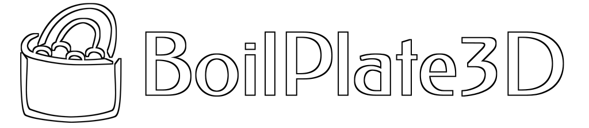

# BoilPlate3D (BP3D)

    
    

### Warning! The project is buggy, unfinished and unpolished in its current state. Some janky features are dubiously necessary and may be removed. 

BP3D (short for BoilPlate3D) is a MASM-compatible (ideally targeting other MASM-compatible assemblers) framework that aims to reduce the amount of redundant boilerplate code by providing a generalized but flexible Win32 form API.

BP3D implements an event-driven form API to easily and quickly create and manage windows, oriented toward developing 3D graphics with OpenGL. It supports automatic configuration of keyboard, mouse, and joystick input. The forms also provide multiple display device functionality. BP3D started along with a game development project, focused on the OpenGL fixed-function pipeline, but was later generalized and restructured into a framework that can be set up with other graphics APIs. Though, realistically, the only reason it exists is that, at the time of making it, I didn't know how to do static linking in MASM. BP3D can be included in a MASM-compatible project and used as-is (with direct access to data fields), or compiled into a dynamic library (to use with helper procedures).

Various BP3D extensions (src\\\*.inc) exist, but for now are generally not as well structured or generalized. The necessity of the existence of some is also debatable.

The version numbers supplied in the headers are individual for each extension (and the main BP3D.asm). Version 1.0 is to be considered feature-complete and fully documented. Suffixes like 'ac' (alpha candidate), 'bc' (beta candidate), and 'rc' (release candidate) may be added at the end of the version number to signify minor changes/fixes to the established feature suite for that version. Though generally abstract, the absence of these suffixes or a lower version number may indicate that an extension is experimental or needs stronger justification for its presence.

## WinAPI client support

BP3D aims to support various WinAPI clients out-of-the-box, with minimal (if any) configuration. The targeted (tested) supported clients include:

- Windows 98SE, ME, 2000 (some APIs may not be present, see BP_COMPATIBILITY_W9X)
- Windows XP - 11
- ReactOS
- Wine (Android (<a href="https://github.com/brunodev85/winlator">Winlator</a>), Linux, BSD)

If BP3D doesn't work (or works improperly) on your WinAPI host OS, please submit an issue with the details of your setup.

## Assembler support

BP3D was built with future x64 support in mind, but that idea has largely been abandoned; x64 compatibility remains unfinished, untested and will likely be removed in the future. Right now, BP3D is tested for compileability with: MASM32, <a href="https://github.com/nidud/asmc">ASMC</a> (2.37.36, 32-bit), and <a href="https://www.terraspace.co.uk/uasm.html">UASM</a> (2.57 32-bit; 64-bit compile only, can't link). POASM and TASM support might be considered in the future. BP3D supports MASM32 and <a href="https://www.terraspace.co.uk/uasm.html#p7">WinInc</a> (2.10) Windows include files (headers and libs).

***

Copyright © 2025-2026 Yevhenii Ionenko (aka GreatCorn). All rights reserved.

Licensed under the terms of the MIT license (see <a href="https://github.com/GreatCorn/BoilPlate3D/blob/main/LICENSE.txt">LICENSE.txt</a>).

https://greatcorn.github.io/me/
